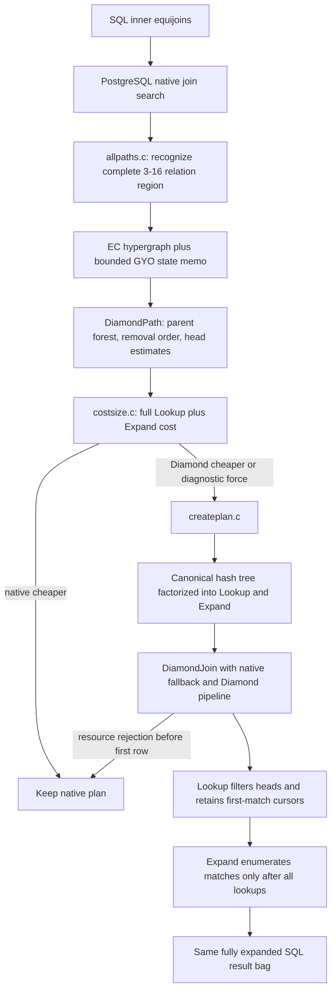

# Diamond-PG midterm: changed files and guided code-reading map

This document is the shortest complete route through the midterm implementation.
It consolidates the architecture, execution plan, implementation plan, testing
ledger, and changelog into an ordered source map for explaining the project.

## Audited snapshot and counting rule

- **Baseline:** PostgreSQL upstream commit **6296e78c3d**.
- **Midterm implementation:** Diamond-PG commit **d26a8c3164**.
- **Git scope:** 45 changed files, 8,538 inserted physical lines and 47 deleted
  physical lines.
- **Non-comment code delta:** **3,220 additions and 42 deletions**:
  **1,849/42 production**, **1,033/0 regression helper/SQL**, and
  **338/0 benchmark tooling**.
- A code line is a changed, nonblank line containing source outside a
  comment. A line containing code followed by a comment counts once. C block
  comments, SQL comments, shell/Python comment-only lines, and Python
  docstrings are excluded. Documentation, expected output, CSV data, and
  schedules are shown as physical data/document deltas instead of code.
- Counts are additions/deletions relative to the baseline, not total file size.
  They were computed from zero-context Git hunks against the old and new file,
  so unchanged PostgreSQL code is not counted.
- This report itself was created after the audited snapshot and is therefore
  not included in the 45-file table.

### Using the links

Open this file in VS Code and press **Ctrl+Shift+V**. Clicking a file or
important-entry link opens that source file. GitHub also resolves the line
anchors. Line labels describe the first important place to read; continue until
the named function or structure ends.

## One-picture execution flow



The central idea is that ordinary joins materialize matches as soon as they are
found. Lookup retains an iterator-like first match while carrying a smaller
head tuple forward. Later lookups can eliminate that head before Expand
enumerates its earlier matches. This avoids large intermediate results without
changing SQL semantics.

## Ordered changed-file table

Read from top to bottom. The ordering follows the dependency chain: node
contracts, retained hash storage, execution, planning, costing, plan creation,
PostgreSQL wiring, tests, benchmarks, and project records.

| Order | File and first important entry                                                                   | Exact non-comment code delta |                Other changed lines | Why it changed and what to understand                                                                                                                                                                                                                                                                                                        |
| ----: | ------------------------------------------------------------------------------------------------ | ---------------------------: | ---------------------------------: | -------------------------------------------------------------------------------------------------------------------------------------------------------------------------------------------------------------------------------------------------------------------------------------------------------------------------------------------- |
|     1 | [plannodes.h — Lookup/Expand/DiamondJoin](../../src/include/nodes/plannodes.h#L1087)             |                    +20 / −0 |                                 — | Defines the serializable physical plan nodes. Lookup inherits HashJoin metadata; Expand names its Lookup owner; DiamondJoin holds the native and factorized alternatives plus memory/cost diagnostics. Start here to learn what can appear in a saved PostgreSQL plan.                                                                       |
|     2 | [pathnodes.h — DiamondPath](../../src/include/nodes/pathnodes.h#L2501)                           |                    +13 / −0 |                                 — | Defines the optimizer candidate before a Plan exists: base scans, GYO parents/removal order, equality clauses, shrinking-head estimates, memory, and force diagnostics.                                                                                                                                                                      |
|     3 | [execnodes.h — runtime states](../../src/include/nodes/execnodes.h#L2255)                        |                    +37 / −0 |                                 — | Defines query-lifetime state. Lookup owns copied probe heads and deferred-match records; Expand borrows them with generation checks; DiamondJoin chooses one branch before exposing a row.                                                                                                                                                   |
|     4 | [hashjoin.h — DiamondHashMatch](../../src/include/executor/hashjoin.h#L119)                      |                    +10 / −0 |                                 — | Adds the private cursor contract over a native hash table and the retained-build sidecar pointer. These pointers never enter SQL tuples or serialized plans.                                                                                                                                                                                 |
|     5 | [nodeLookupExpand.h — deferred records](../../src/include/executor/nodeLookupExpand.h#L11)       |                    +29 / −0 |                                 — | Declares the GUCs, executor entry points, deferred match record, resource error, and retained-build helpers shared by Hash, Lookup, Expand, and DiamondJoin.                                                                                                                                                                                 |
|     6 | [nodeHash.h — scanner API](../../src/include/executor/nodeHash.h#L51)                            |                     +8 / −3 |                                 — | Exposes one native equality scanner as ExecHashLookup/ExecHashExpand and changes insertion to return the stored tuple address needed by the sidecar.                                                                                                                                                                                         |
|     7 | [nodeHashjoin.h — executor switches](../../src/include/executor/nodeHashjoin.h#L21)              |                     +6 / −0 |                                 — | Declares instrumentation/experimental controls and the shared HashJoin initialization used by Lookup instead of duplicating the native state machine.                                                                                                                                                                                        |
|     8 | [instrument_node.h — counters](../../src/include/executor/instrument_node.h#L267)                |                    +11 / −0 |                                 — | Adds query and worker counters for probes, successful probes, and build matches. This was Phase 1 evidence and remains useful for EXPLAIN and correctness diagnosis.                                                                                                                                                                         |
|     9 | [nodeHash.c — retained build and scanners](../../src/backend/executor/nodeHash.c#L1788)          |                   +82 / −15 |                                 — | Makes insertion return a stable batch-owned tuple, rejects batching for retained builds, and implements the common Lookup/Expand equality scan. Read ExecHashTableInsert, ExecHashLookup at line 2112, and ExecHashExpand at line 2139.                                                                                                      |
|    10 | [nodeHashjoin.c — shared native state machine](../../src/backend/executor/nodeHashjoin.c#L236)   |                  +210 / −12 |                                 — | Reuses native build, probing, quals, batching, rescan, cursor, and parallel-instrumentation behavior. Lookup stops after the first equality match and publishes the head; native HashJoin behavior remains the fallback. Read ExecHashJoinImpl, initialization near line 961, eligibility near line 1216, and cleanup/rescan guards.         |
|    11 | [nodeLookupExpand.c — main executor](../../src/backend/executor/nodeLookupExpand.c#L112)         |                   +449 / −0 |                                 — | Implements retained sidecar construction, Lookup, Expand, ownership generations, copied probes, rescans, and DiamondJoin’s pre-output resource fallback. This is the most important executor file: read ExecLookup at 227, ExecExpand at 336, and ExecDiamondJoin at 518.                                                                   |
|    12 | [allpaths.c — acyclic optimizer search](../../src/backend/optimizer/path/allpaths.c#L3964)       |                   +370 / −3 |                                 — | Adds Diamond only after normal/GEQO join search. It recognizes a complete legal 3–16 relation inner-equijoin region, builds attributes from PostgreSQL EquivalenceClasses, performs GYO ear removal, memoizes distinct minimized forests, estimates shrinking heads, and submits only fully expanded candidates. Native paths stay present. |
|    13 | [costsize.c — cost_diamond_path](../../src/backend/optimizer/path/costsize.c#L6894)              |                   +119 / −0 |                                 — | Converts the selected Lookup/Expand schedule into PostgreSQL cost units: scan/hash work, lookup probes, delayed enumeration, output CPU, and resident-memory estimates. The full expanded cost competes with native paths.                                                                                                                   |
|    14 | [cost.h — costing declaration](../../src/include/optimizer/cost.h#L228)                          |                     +1 / −0 |                                 — | Makes the Diamond costing entry point visible to planner code.                                                                                                                                                                                                                                                                               |
|    15 | [createplan.c — canonicalize and factorize](../../src/backend/optimizer/plan/createplan.c#L4396) |                   +334 / −0 |                                 — | Converts DiamondPath into a legal native canonical hash tree, fixes references, then factorizes it bottom-up into Lookup/Expand nodes. It also independently constructs an ordinary serial native fallback. Read create_diamond_join_plan at 4455, diamond_factorize at 4546, and create_diamond_lookup_expand at 4714.                      |
|    16 | [planmain.h — plan helpers](../../src/include/optimizer/planmain.h#L43)                          |                     +3 / −0 |                                 — | Declares factorization/reference helpers used during standard plan finalization.                                                                                                                                                                                                                                                             |
|    17 | [setrefs.c — reference-fixing boundary](../../src/backend/optimizer/plan/setrefs.c#L1375)        |                     +5 / −0 |                                 — | Ensures Diamond’s two-stage reference transformation happens at the correct PostgreSQL boundary and ordinary HashJoin plans are not accidentally rewritten.                                                                                                                                                                                 |
|    18 | [subselect.c — plan-tree traversal](../../src/backend/optimizer/plan/subselect.c#L3119)          |                     +1 / −0 |                                 — | Teaches parameter/subplan finalization to traverse DiamondJoin correctly.                                                                                                                                                                                                                                                                    |
|    19 | [execProcnode.c — executor dispatch](../../src/backend/executor/execProcnode.c#L313)             |                    +20 / −0 |                                 — | Connects plan tags to initialization, execution, and shutdown of Lookup, Expand, and DiamondJoin. Without dispatch, the new plan nodes cannot run.                                                                                                                                                                                           |
|    20 | [execAmi.c — rescan dispatch](../../src/backend/executor/execAmi.c#L254)                         |                    +10 / −0 |                                 — | Routes rescans through DiamondJoin so prepared plans, nested loops, cursors, and repeated execution reset ownership safely.                                                                                                                                                                                                                  |
|    21 | [execParallel.c — parallel boundary](../../src/backend/executor/execParallel.c#L317)             |                    +11 / −9 |                                 — | Preserves native parallel HashJoin instrumentation but explicitly rejects private Lookup/Expand sidecars inside parallel execution. This prevents cross-process pointer misuse.                                                                                                                                                              |
|    22 | [explain.c — visible plan evidence](../../src/backend/commands/explain.c#L1445)                  |                    +57 / −0 |                                 — | Names Diamond Join/Lookup/Expand and reports memory estimates, force status, fallback, and native HashJoin counters. This is what makes the professor demo inspectable.                                                                                                                                                                      |
|    23 | [ruleutils.c — deparsing INNER_VAR](../../src/backend/utils/adt/ruleutils.c#L5214)               |                     +9 / −0 |                                 — | Resolves Expand’s deferred build-side variables back to the owning Lookup when PostgreSQL deparses expressions.                                                                                                                                                                                                                             |
|    24 | [guc_parameters.dat — user controls](../../src/backend/utils/misc/guc_parameters.dat#L814)       |                    +30 / −0 |                                 — | Adds diamond_acyclic, diagnostic force, instrumentation, and earlier execution-phase controls. diamond_acyclic is the normal midterm switch.                                                                                                                                                                                                 |
|    25 | [guc_tables.c — enum visibility](../../src/backend/utils/misc/guc_tables.c#L54)                  |                     +2 / −0 |                                 — | Makes the developer GUC group available through PostgreSQL’s generated configuration tables.                                                                                                                                                                                                                                                |
|    26 | [executor Makefile](../../src/backend/executor/Makefile#L55)                                      |                     +1 / −0 |                                 — | Compiles nodeLookupExpand.c in Make builds.                                                                                                                                                                                                                                                                                                  |
|    27 | [executor meson.build](../../src/backend/executor/meson.build#L43)                                |                     +1 / −0 |                                 — | Compiles the same executor in Meson builds.                                                                                                                                                                                                                                                                                                  |
|    28 | [regress.c — plan-construction helpers](../../src/test/regress/regress.c#L77)                    |                   +331 / −0 |                                 — | Builds controlled nested Lookup/Expand and automatic Diamond plans inside the regression module, allowing ownership, serialization, memory fallback, and execution invariants to be tested directly.                                                                                                                                         |
|    29 | [diamond_hashjoin.sql — behavioral oracle](../../src/test/regress/sql/diamond_hashjoin.sql#L1)   |                   +702 / −0 |                                 — | Tests counters, duplicates, NULLs, multi-key/text keys, projections, filters, rescans, parameters, cursors, cancellation, copied plans, GEQO, batching/memory rejection, cycles and unsupported native fallback, plus multiset equality via EXCEPT ALL.                                                                                      |
|    30 | [diamond_hashjoin.out](../../src/test/regress/expected/diamond_hashjoin.out#L1)                   |                           — | +1,269 / −0 expected-output lines | Stores reviewed expected results for the regression SQL. It is evidence, not implementation code.                                                                                                                                                                                                                                            |
|    31 | [parallel_schedule](../../src/test/regress/parallel_schedule#L131)                                |                           — |            +1 / −1 schedule lines | Adds diamond_hashjoin to the standard core regression schedule.                                                                                                                                                                                                                                                                              |
|    32 | [config.sgml — documented GUCs](../../doc/src/sgml/config.sgml#L13023)                           |                           — |     +137 / −0 documentation lines | Documents the developer switches in the PostgreSQL manual rather than leaving hidden implementation controls.                                                                                                                                                                                                                                |
|    33 | [benchmark.py — correctness and timing engine](../../scripts/diamond-pg/benchmark.py#L1)         |                   +210 / −0 |                                 — | Alternates native/automatic modes, compares complete result bags, runs three EXPLAIN ANALYZE repetitions, records raw plans/counters/errors, prints speedups, and checkpoints the compact tracked CSV.                                                                                                                                       |
|    34 | [_run-benchmark.sh — common runner](../../scripts/diamond-pg/_run-benchmark.sh#L1)               |                   +125 / −0 |                                 — | Builds the current checkout, starts an isolated server, validates or prepares datasets, runs one suite, records identity, and always stops the server. Shared logic prevents three divergent setup scripts.                                                                                                                                  |
|    35 | [run-paper-microbenchmark.sh](../../scripts/diamond-pg/run-paper-microbenchmark.sh#L1)            |                     +1 / −0 |                                 — | Public entry point for the self-contained three-scale paper fixture and N=5000 plan demo.                                                                                                                                                                                                                                                    |
|    36 | [run-tpch-benchmark.sh](../../scripts/diamond-pg/run-tpch-benchmark.sh#L1)                        |                     +1 / −0 |                                 — | Public entry point for 22 correctness-checked TPC-H SF1 comparisons.                                                                                                                                                                                                                                                                         |
|    37 | [run-job-benchmark.sh](../../scripts/diamond-pg/run-job-benchmark.sh#L1)                          |                     +1 / −0 |                                 — | Public entry point for 113 correctness-checked JOB comparisons and explicit one-time data loading.                                                                                                                                                                                                                                           |
|    38 | [benchmark-results.csv](../../scripts/diamond-pg/benchmark-results.csv#L1)                        |                           — |              +139 / −0 data lines | Keeps one compact row per TPC-H, JOB, and paper query with bags, medians, selections, executor counters, errors, and planner diagnosis. Raw plans remain ignored.                                                                                                                                                                            |
|    39 | [ARCHITECTURE.md](ARCHITECTURE.md#L1)                                                             |                           — |     +679 / −0 documentation lines | Explains the PostgreSQL-to-paper mapping, ownership/lifetime model, native HashJoin surfaces, and phase-by-phase architecture.                                                                                                                                                                                                               |
|    40 | [IMPLEMENTATION_PLAN.md](IMPLEMENTATION_PLAN.md#L1)                                               |                           — |     +262 / −0 documentation lines | Records completed phases, acceptance criteria, boundaries, and remaining Expand3/generalization work.                                                                                                                                                                                                                                        |
|    41 | [EXECPLAN.md](EXECPLAN.md#L1)                                                                     |                           — |     +238 / −0 documentation lines | Gives the final execution/planner checkpoint, correction rationale, costing status, evaluation, and handoff.                                                                                                                                                                                                                                 |
|    42 | [TESTING.md](TESTING.md#L1)                                                                       |                           — |   +1,095 / −0 documentation lines | Contains exact build/test/benchmark commands and the evidence ledger, including focused 1/1 and core 240/240 results.                                                                                                                                                                                                                        |
|    43 | [CHANGELOG.md](CHANGELOG.md#L1)                                                                   |                           — |     +473 / −0 documentation lines | Preserves the chronological decisions, actual results, failures, limitations, and phase transitions consolidated here.                                                                                                                                                                                                                       |
|    44 | [AGENTS.md](../../AGENTS.md#L1)                                                                   |                           — |  +146 / −0 process-document lines | Stores permanent repository rules: semantics first, native fallback, minimal changes, authorship, comments, testing, and documentation discipline.                                                                                                                                                                                           |
|    45 | [.gitignore](../../.gitignore#L27)                                                                |                           — |       +3 / −0 configuration lines | Keeps generated builds, clusters, downloaded datasets, raw plans, and logs out of Git.                                                                                                                                                                                                                                                       |

## Incremental understanding: what was implemented and why

<details open>
<summary><strong>Stage 1 — Establish the native measurement baseline</strong></summary>

PostgreSQL HashJoin already performs the hash build, bucket probing, equality
recheck, residual qualification, batching, rescans, and parallel work. Before
changing execution, Phase 1 added optional counters in
[instrument_node.h](../../src/include/executor/instrument_node.h#L267),
[nodeHashjoin.c](../../src/backend/executor/nodeHashjoin.c#L572), and
[explain.c](../../src/backend/commands/explain.c#L3433).

Why it was necessary: a claimed optimization needs to distinguish hash probes,
successful probes, build matches, and emitted rows. Timing alone cannot show
whether the intended mechanism actually ran.

What to say: **we first instrumented native HashJoin without changing its
result or default plan, establishing observable baseline work.**

</details>

<details>
<summary><strong>Stage 2 — Split “find a match” from “enumerate every match”</strong></summary>

The paper’s key operation is not a new hash table. It is a different use of a
hash table:

1. **Lookup** probes a build hash, verifies equality, remembers the first
   matching tuple/cursor, and emits only the current head.
2. More Lookups can reject that head.
3. **Expand** later resumes each retained cursor and emits every matching build
   tuple required for the final SQL result.

[nodeHash.c](../../src/backend/executor/nodeHash.c#L2070) provides the common
scanner. [nodeHashjoin.c](../../src/backend/executor/nodeHashjoin.c#L236)
reuses PostgreSQL’s state machine. Immediate Lookup/Expand first proved that a
single HashJoin could pause and resume correctly.

Why it was necessary: expanding early can create a quadratic intermediate that
a later join discards. Retaining a cursor keeps only a compact possibility
until all selective lookups have succeeded.

</details>

<details>
<summary><strong>Stage 3 — Make Lookup and Expand independent physical nodes</strong></summary>

Immediate Lookup/Expand could not be scheduled across a multi-join plan.
[plannodes.h](../../src/include/nodes/plannodes.h#L1087) therefore introduces
real Lookup and Expand nodes, and
[nodeLookupExpand.c](../../src/backend/executor/nodeLookupExpand.c#L227)
implements them.

The hard part is lifetime, not probing. A cursor points into hash-batch memory.
The implementation therefore:

- copies each probe head into a query-owned context;
- keeps deferred records private, never as SQL Datums;
- pins retained builds to a single batch;
- records owner/storage generations;
- checks generations before dereferencing borrowed tuples;
- invalidates cursors before rebuild, rescan, shutdown, or cancellation.

Why it was necessary: independent scheduling is only correct when every
retained iterator has a provable owner and lifetime.

</details>

<details>
<summary><strong>Stage 4 — Recognize alpha-acyclic query regions</strong></summary>

[allpaths.c](../../src/backend/optimizer/path/allpaths.c#L3964) runs after
PostgreSQL’s normal join search. For a complete legal 3–16 relation region it:

1. builds hypergraph attributes from PostgreSQL EquivalenceClasses;
2. performs GYO ear removal;
3. rejects a genuine cycle when no ear exists;
4. enumerates legal removal/root choices;
5. memoizes distinct minimized parent forests;
6. tracks the expected head size after every Lookup;
7. preserves only a bounded best state per comparable expression;
8. creates a fully expanded DiamondPath.

Using EquivalenceClasses matters. Equalities R.a=S.a and S.a=T.a describe one
shared attribute, not a fake three-edge cycle.

Why it was necessary: Lookup order decides which intermediate matches are
delayed. PostgreSQL must search legal factorized schedules, not merely rewrite
the SQL join order.

</details>

<details>
<summary><strong>Stage 5 — Cost the complete expression and retain native competition</strong></summary>

[costsize.c](../../src/backend/optimizer/path/costsize.c#L6894) accounts for
hash builds, probes over shrinking heads, eventual Expand enumeration, output
CPU, and resident bytes. Only a fully expanded expression competes in
add_path; an internal filtered head is not a relational result and cannot be
compared with a native join path.

The diagnostic force switch applies only after semantic and memory eligibility.
It exposes rejected eligible candidates without making unsupported plans legal.

Why it was necessary: the paper supplies algebraic scheduling, while PostgreSQL
still needs native cost units and memory safety to choose between physical
plans.

</details>

<details>
<summary><strong>Stage 6 — Construct both executable branches</strong></summary>

[createplan.c](../../src/backend/optimizer/plan/createplan.c#L4396) first builds
a normal canonical hash tree. It then reference-fixes and factorizes that tree
into Lookup/Expand. The DiamondJoin plan contains:

- the independently built ordinary serial native plan;
- the factorized Diamond pipeline;
- estimated resident memory and original candidate cost.

At execution start, [ExecDiamondJoin](../../src/backend/executor/nodeLookupExpand.c#L518)
prepares the factorized branch. If actual retained storage cannot remain safe,
it selects native before returning the first row. It never switches branches
after output begins.

Why it was necessary: estimates can be wrong. A pre-output fallback preserves
the SQL bag without trying to merge partial results from two executions.

</details>

<details>
<summary><strong>Stage 7 — Integrate with all PostgreSQL lifecycle surfaces</strong></summary>

New nodes need more than an ExecProcNode function. The implementation covers:

- node creation and dispatch in
  [execProcnode.c](../../src/backend/executor/execProcnode.c#L313);
- rescans in [execAmi.c](../../src/backend/executor/execAmi.c#L254);
- reference fixing and subplan traversal;
- expression deparsing;
- EXPLAIN visibility;
- generated GUC registration;
- copy/read/out behavior supplied by annotated node headers;
- explicit parallel rejection for pointer-bearing sidecars.

Why it was necessary: missing one lifecycle surface can make prepared
statements, cursors, cancellation, copied plans, or EXPLAIN fail even when a
simple SELECT works.

</details>

<details>
<summary><strong>Stage 8 — Prove correctness and measure actual selection</strong></summary>

The regression test compares bags with EXCEPT ALL, so duplicates are preserved.
It covers NULLs, text/multiple keys, filters, projections, rescans, parameters,
cached plans, cursors, cancellation, serialization, GEQO, memory rejection,
and unsupported/cyclic native fallback.

Final source validation passed focused Diamond **1/1** and PostgreSQL core
**240/240**. The paper fixture selected one Diamond region and executed two
Lookups/two Expands:

- N=1,000: 212.040 ms native / 1.055 ms automatic = **200.99×**.
- N=5,000: 2,625.554 ms / 3.923 ms = **669.27×**.
- N=50,000: automatic 30.785 ms; native exceeded 120 seconds.

Final TPC-H SF1 completed 22/22 equal bags with zero selections and a geometric
native/automatic ratio of 1.00107. This is a correctness/neutrality result, not
a real-suite speedup claim. The current conservative scope and cost model often
leave JOB/TPC-H native.

</details>

## The N=5000 professor-demo example

The generated query is:

```sql
SELECT x.a, x.b, y.c, z.d
FROM x5000 x
JOIN y5000 y ON x.b = y.b
JOIN z5000 z ON y.c = z.c;
```

- X has one b=1 row and 5,000 b=2 rows.
- Y has one (b=1,c=1) row, 4,997 (b=2,c=4..5000) rows, and
  4,998 (b=3..5000,c=3) rows.
- Z has one c=1 row and 5,000 c=3 rows.
- Native X join Y forms **24,985,001** rows, then Z rejects all but one.
- Diamond scans Y as the head. Lookup X retains 4,998 possible heads; Lookup Z
  retains one; the two Expands then produce the same sole (1,1,1,1) result.

Run the measured comparison and print both plans:

```sh
DIAMOND_PG_QUERY=n05000 DIAMOND_PG_DEMO=1   scripts/diamond-pg/run-paper-microbenchmark.sh
```

In the output, point to **Diamond Join**, two **Diamond Lookup** nodes, two
**Diamond Expand** nodes, equal result bags, and the native/automatic medians.

## What is deliberately outside the midterm

- Cyclic Expand3 is not implemented.
- Outer, semi, anti, inequality, lateral, mutable/security-sensitive, and
  unsupported residual regions stay native.
- The bounded optimizer handles complete 3–16 relation alpha-acyclic inner
  equijoins over regular heap relations.
- Lookup/Expand’s private pointer sidecars do not execute in parallel workers.
- General partial-region and boundary-driven early-Expand search remains future
  work.
- TPC-H/JOB improvement is not claimed where the optimizer selects no Diamond
  plan.

These are explicit safety boundaries. The project’s correctness argument is
that supported candidates are additional costed alternatives and every other
case retains normal PostgreSQL behavior.

## Recommended reading sequence for the group

1. Read the diagram and demo example in this file.
2. Read the three plan structures in
   [plannodes.h](../../src/include/nodes/plannodes.h#L1087).
3. Read runtime ownership in
   [execnodes.h](../../src/include/nodes/execnodes.h#L2255).
4. Read Lookup, Expand, and DiamondJoin in
   [nodeLookupExpand.c](../../src/backend/executor/nodeLookupExpand.c#L227).
5. Read the native cursor scanner in
   [nodeHash.c](../../src/backend/executor/nodeHash.c#L2070).
6. Read the GYO/memo planner in
   [allpaths.c](../../src/backend/optimizer/path/allpaths.c#L3964).
7. Read costing in
   [costsize.c](../../src/backend/optimizer/path/costsize.c#L6894).
8. Read factorization in
   [createplan.c](../../src/backend/optimizer/plan/createplan.c#L4396).
9. Skim lifecycle wiring and EXPLAIN.
10. Read representative correctness cases in
    [diamond_hashjoin.sql](../../src/test/regress/sql/diamond_hashjoin.sql#L176).
11. Run the N=5000 demo and connect each plan node to the code above.
